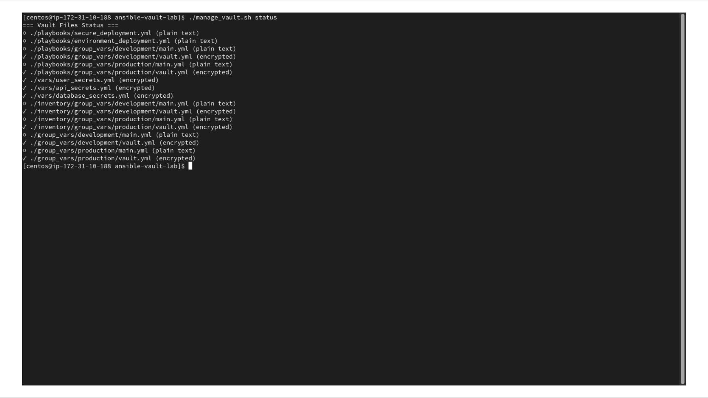
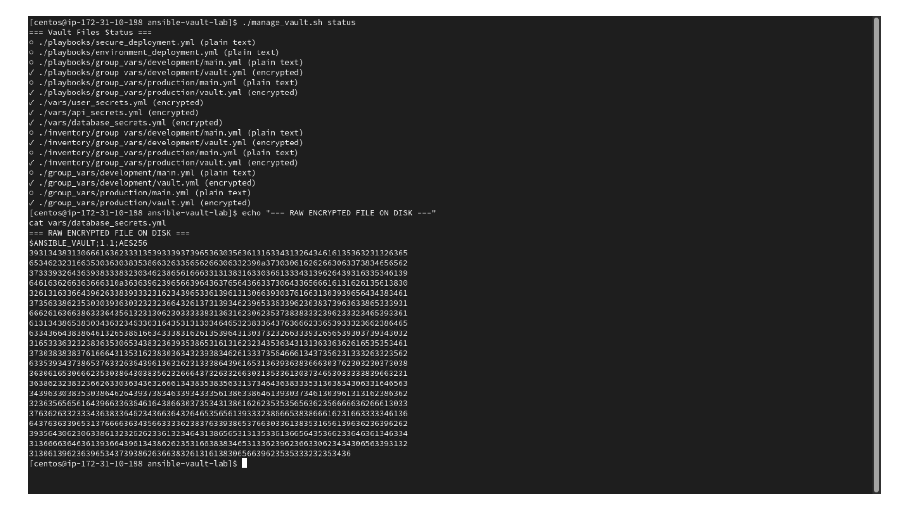
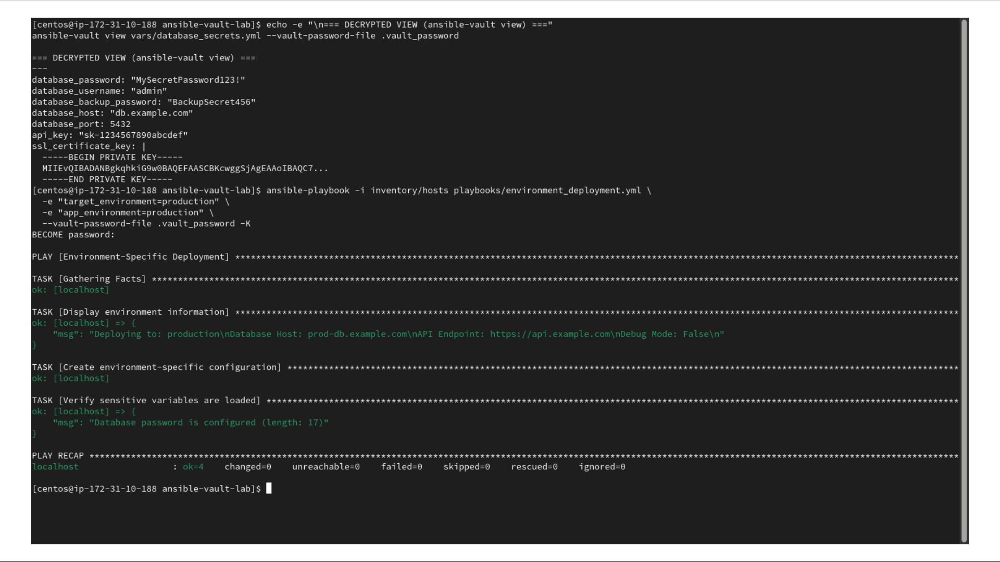
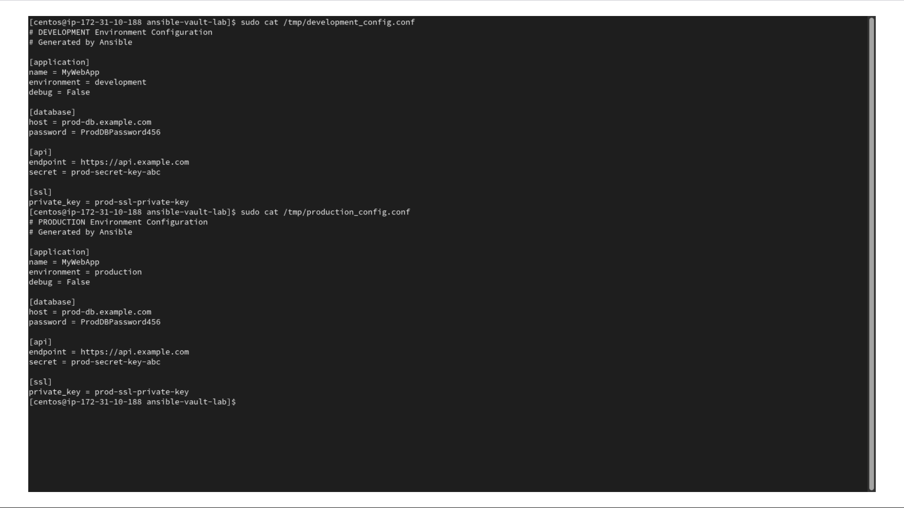
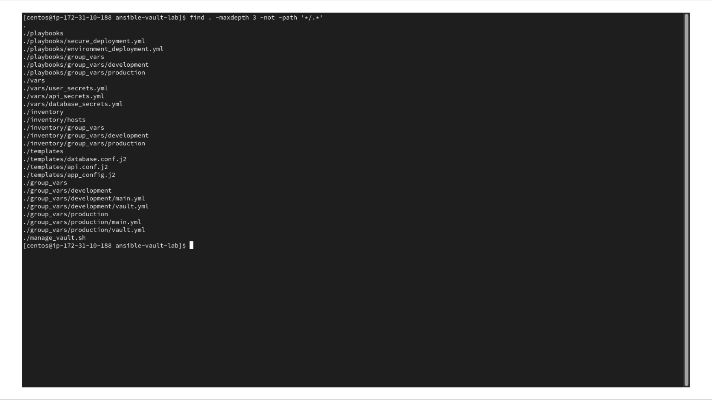

# Module 15: Ansible Vault - Enterprise Sensitive Data Management


## Overview

This repository demonstrates enterprise-grade secrets management using **Ansible Vault** within infrastructure automation pipelines. It covers encrypting sensitive credentials (passwords, API keys, private keys), integrating encrypted variables into playbooks, separating environment configurations using `group_vars`, and automating secure playbook execution using vault password files.

## Architecture & Workflow

```text
├── inventory/
│   ├── hosts
│   └── group_vars/
│       ├── development/
│       │   ├── main.yml         # Plaintext development variables
│       │   └── vault.yml         # AES-256 encrypted development secrets
│       └── production/
│           ├── main.yml         # Plaintext production variables
│           └── vault.yml         # AES-256 encrypted production secrets
├── playbooks/
│   ├── secure_deployment.yml     # Core deployment tasks
│   └── environment_deployment.yml# Multi-environment target deployment
├── templates/
│   ├── app_config.j2             # Jinja2 template for application configs
│   ├── api.conf.j2               # Jinja2 template for API credentials
│   └── database.conf.j2          # Jinja2 template for database connections
├── vars/
│   ├── api_secrets.yml           # Encrypted API keys
│   ├── database_secrets.yml      # Encrypted database credentials
│   └── user_secrets.yml          # Encrypted user management credentials
├── manage_vault.sh               # Shell utility for batch vault management
└── .vault_password               # Local vault key (excluded via .gitignore)
```

## Key Objectives Completed

* **AES-256 Encryption**: Protected passwords, private keys, and API tokens on disk.
* **Dynamic Decryption**: Decrypted secrets in-memory during execution without exposing plaintext files.
* **Environment Isolation**: Configured separate variable scopes (development vs. production) inside `group_vars`.
* **Template Rendering**: Rendered runtime configuration files dynamically using Jinja2 templates (`/tmp/*_config.conf`).
* **Automation Helper**: Created `manage_vault.sh` to audit encryption status across the repository.

---

## Technical Visuals & Proof of Implementation

### 1. Vault File Encryption Audit
Verified encryption status across all YAML variable files in the workspace:
  
*Verification: Executing `./manage_vault.sh status` successfully identifies encrypted vs. plaintext files [cite: 37].*

### 2. Ciphertext Inspection vs. Decrypted View
Demonstrated raw AES-256 encrypted ciphertext stored on disk (`cat`) alongside dynamic in-memory viewing via Ansible Vault (`ansible-vault view`):
  
*Verification: Raw on-disk ciphertext displayed as AES-256 binary structure [cite: 38].*

  
*Verification: In-memory decrypted view and successful playbook execution [cite: 39].*

### 3. Secure Automated Execution
Ran non-interactive deployments passing `.vault_password` securely during playbook execution:
```bash
ansible-playbook -i inventory/hosts playbooks/environment_deployment.yml   -e "target_environment=production"   -e "app_environment=production"   --vault-password-file .vault_password
```

### 4. Verified Rendered Configurations
Confirmed that Jinja2 templates correctly extracted decrypted vault secrets into secure system configuration files:
  
*Verification: Successfully inspected generated configuration files via `sudo cat /tmp/*_config.conf` [cite: 40].*

### 5. Repository Directory Layout
Final project directory structure following standard Ansible best practices:
  
*Verification: Confirmed tree structure layout using `find` [cite: 41].*

---

## Security Best Practices Implemented

* **Strict File Permissions**: Restricted `.vault_password` access to `0600` (`chmod 600 .vault_password`).
* **Version Control Protection**: Ensured plain text secrets and key files are untracked by adding them to `.gitignore`.
* **Variable Scope Hygiene**: Renamed custom variables to avoid collisions with Ansible internal keywords (e.g., using `app_environment` instead of `environment`).
* **Least Privilege System Users**: Configured generated configuration files with `0600` file permissions owned by root.
